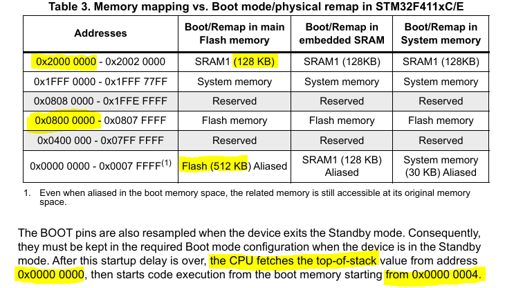

# stm32f411-baremetal-secure-boot
Modular bare metal firmware framework with secured dual slot bootloader for stm32f411CEU6

## Objectives
- Build a zero-HAL, register-level bare-metal firmware architecture from scratch.
- Set up a complete custom toolchain build and debug workflow without IDE code generators.
- Design and implement a **dual-slot secure bootloader** supporting firmware updates, integrity checks, and rollback recovery.
- Document architecture decisions, memory layouts, and reference manual findings step by step.

## Memory Exploration & Flash Organization

### Conclusions (as per RM0383)

1. **Flash** starts at 0x08000000, size 512KB -> to be used in the linker script ("MEMORY" region).
2. **SRAM** starts at 0x20000000, size 128KB -> to be used in the linker script ("MEMORY" region).
3. **Vector table layout** (the first two words of the boot memory):
   - 0x00000000 holds the initial stack pointer value (top of stack).
   - 0x00000004 holds the address of `Reset_Handler`.
   -> to be used in the startup code and the linker script.

### Notes

- **Flash alias:** the address `0x00000000` is only an alias. Its target changes with the BOOT pins configuration (main Flash, embedded SRAM, or System memory). The real Flash address is 0x08000000
- **System memory:** a 30KB region at `0x1FFF0000` holds ST's built-in bootloader. It may be useful later as a fallback (USB DFU / UART).

